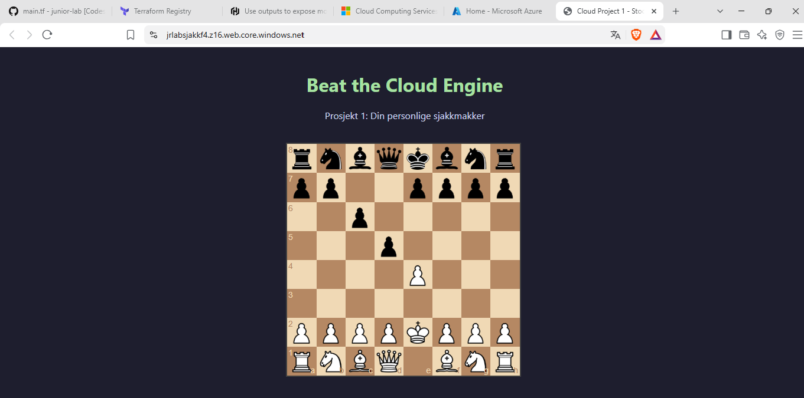
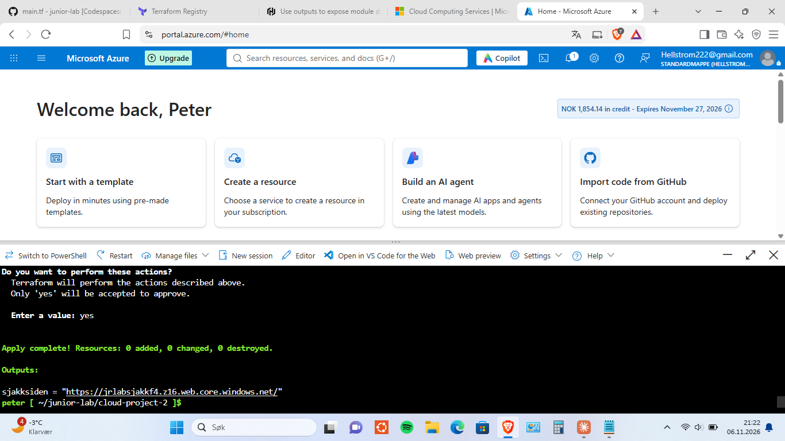

# Prosjekt 2: Sjakksiden i Azure, bygget med Terraform

Dette prosjektet bruker Terraform til å bygge en statisk nettside i Azure og legge sjakksiden fra [Prosjekt 1](../cloud-project-1) ut på internett. Hele oppsettet er beskrevet i én fil, `main.tf`, og kan bygges og fjernes igjen med kommandoer.



## Hva prosjektet gjør

Jeg skriver en Terraform-fil (`main.tf`) som forteller Terraform hva den skal lage i Azure, og Terraform bygger det.

Jeg valgte storage account med static website fordi siden er statisk og ingen kode kjører på serversiden. Jeg valgte bort VM, VNet, database og API fordi siden ikke trenger noe av det akkurat nå.

## Slik kjører jeg det

Jeg skriver koden i GitHub Codespaces og kjører Terraform fra Azure Cloud Shell, fordi innlogging med device code fra Codespaces ble blokkert av security defaults på den nye Azure-kontoen.

```
# I Codespaces (der jeg skriver koden)
terraform fmt
terraform validate
git add <filer>
git commit -m "Beskrivelse"
git push

# I Cloud Shell (der jeg kjører den)
git clone https://github.com/Jibsterr/junior-lab    # bare første gang
cd junior-lab/cloud-project-2
git pull
terraform init                                      # bare første gang
terraform plan
terraform apply
terraform output
terraform destroy                                   # når dagen er over
```

| Kommando | Hva den gjør |
|---|---|
| `terraform init` | Laster ned pluginen som lar Terraform snakke med Azure |
| `terraform fmt` | Rydder opp i utseendet på filene |
| `terraform validate` | Sjekker at koden er gyldig |
| `terraform plan` | Viser hva som vil skje, uten å bygge noe |
| `terraform apply` | Bygger ressursene |
| `terraform output` | Viser nettadressen |
| `terraform destroy` | Fjerner alt jeg har bygget |

Før jeg kjører `apply`, leser jeg alltid planen og ser etter `destroy` og `change`.

## Strukturen i main.tf

```
Resource group  JR-Lab                      (mappen alt ligger i)
└── Storage account  jrlabsjakkf4           ← henviser til resource group
    ├── Static website-innstilling          ← henviser til storage account
    └── Container $web                      ← lages av Azure, slås opp med data
        │                                      (henviser til storage account + depends_on static website)
        └── Blob index.html                 ← henviser til containeren
Output                                      ← henter adressen fra storage account
```

Først ga jeg blokkene navn og etiketter som ikke sa hva de var (for eksempel brukte jeg samme etikett på både static website og blob), og det gjorde henvisningene forvirrende å lese. Nå heter storage account-blokken `"azurerm_storage_account" "storage"`, og det er lett å se hva jeg henviser til nedover i filen. Rekkefølgen i filen har ikke noe å si for hva som bygges, siden Terraform finner rekkefølgen selv ut fra henvisningene. Jeg har likevel lagt blokkene i samme rekkefølge som treet over, for at filen skal være lett å lese.

Containeren `$web` lager jeg ikke selv i Terraform. Azure lager den selv når static website slås på. Terraform kan derfor ikke slå den opp før static website er på. Jeg la en `depends_on` i data-blokken, som får den til å vente på static website-blokken. Blob-en henviser til data-blokken og venter dermed på begge.

## Feilsøking

### 1. Riktig verdi i feil felt (`type` og `content_type`)
- **Hva skjedde:** I blob-blokken skrev jeg `text/html` i `type`. Terraform stoppet meg før noe ble bygget, og feilmeldingen sa at `type` bare godtar `Append`, `Block` eller `Page`.
- **Hvorfor:** En blob er en fil i Azure Storage. `type` sier hvordan Azure lagrer filen, og `Block` er riktig for vanlige filer som min `index.html`. `text/html` hører hjemme i `content_type`, som forteller nettleseren hva slags innhold filen har. Uten den kan nettleseren i teorien laste ned filen i stedet for å vise den (har ikke testet det).
- **Løsning:** `type = "Block"` og en egen linje `content_type = "text/html"`.
- **Det jeg tok med meg:** Terraform sjekker koden før noe bygges, og feilmeldingen viser de lovlige verdiene.

### 2. Henvisninger: `data.` først og `.id` til slutt
- **Hva skjedde:** Jeg fikk to feilmeldinger: "Reference to undeclared resource" og "string required, but have object".
- **Hvorfor:** En henvisning er en adresse til en verdi i en annen blokk, og den har tre deler: `typen.etiketten.feltet`. Hvis blokken jeg peker på starter med `data` (et oppslag av noe som allerede finnes, som containeren `$web`), skal `data.` stå først. Starter den med `resource`, skal det ikke stå. `.id` er feltet som gir ID-en. Uten et felt til slutt får jeg hele blokken (et objekt) i stedet for én verdi (en streng).
- **Løsning:** `data.azurerm_storage_container.web.id` til containeren og `azurerm_storage_account.storage.id` til storage account.
- **Det jeg tok med meg:** Jeg spør meg selv hvilken blokktype jeg peker på, og hvilken enkeltverdi feltet trenger.

### 3. Output skrev ut ID-en i stedet for nettadressen
- **Hva skjedde:** Etter `apply` skrev output ut en lang tekst som begynte med `/subscriptions/...`, og ikke nettadressen.
- **Hvorfor:** Jeg hadde `.id` på slutten, som er Azures interne ID. Nettadressen er et annet felt på storage account, `primary_web_endpoint`. Det jeg fyller inn i en blokk, kalles argumenter. Det blokken gir tilbake etter at den er bygget, kalles attributter. Attributtene står i "Attributes Reference" i dokumentasjonen og som `(known after apply)` i planen.
- **Løsning:** Jeg byttet `.id` med `.primary_web_endpoint`.
- **Det jeg tok med meg:** Argumenter er det jeg gir inn, attributter er det jeg får ut.


Jeg testet terraform destroy og så apply på nytt, og siden kom opp igjen uten manuelle endringer.

## Hva som holdes utenfor GitHub

`.gitignore` holder hemmeligheter (passord, nøkler, tilgangsstrenger), store filer som `.terraform/` som kan lastes ned igjen, og filer som bare gjelder min maskin, utenfor GitHub. `terraform.tfstate` er Terraforms hukommelse om hva den har bygget, og kan inneholde nøkler i klartekst, så den må aldri committes.

`.gitignore` hindrer at filer blir committet. Hvis en hemmelighet først blir pushet til et offentlig repo, er den lekket, også om jeg sletter den senere.

Jeg sjekker at det virker med denne kommandoen i Cloud Shell:

```
git check-ignore -v cloud-project-2/terraform.tfstate
```

Ingen utskrift betyr at filen ikke er ignorert, og da må det fikses før jeg committer mer.

`.terraform.lock.hcl` er med i repoet. Den låser pluginversjonen, slik at koden gir samme resultat etter fremtidige oppdateringer.

Da jeg satte opp Cloud Shell, opprettet Azure en egen resource group for lagring av filene mine. Den ble laget utenfor Terraform, så `terraform destroy` fjerner den ikke, og den er adskilt fra `JR-Lab` som Terraform bygger.

## Begrensninger og neste steg

- **Ingen pipeline ennå.** Jeg gjør alt for hånd (add, commit, push, pull, plan, apply). En pipeline er en automatisk kjede av steg som kjører når jeg pusher. Det blir Prosjekt 3 med GitHub Actions.
- **State ligger bare i Cloud Shell.** I Prosjekt 3 lager jeg et felles sted for den, slik at jeg og roboten bruker samme hukommelse.
- **`required_providers` er ikke lagt til.** Pluginversjonen er låst i `.terraform.lock.hcl`, men ikke skrevet inn i koden.
- **Budsjettvarsel i Azure er ikke satt opp.** Jeg fikk det ikke opprettet, og holder kostnadene nede med `terraform destroy`.
- **Siden er bare oppe mens ressursene er bygget.** Etter `destroy` er adressen borte.

## Hva jeg lærte

- Hvordan Terraform leser en fil med blokker og bygger det som står der. Jeg beskriver ønsket resultat, og Terraform finner rekkefølgen.
- Forskjellen på `resource` (Terraform lager og eier) og `data` (Terraform leser noe som allerede finnes).
- Henvisninger: `typen.etiketten.feltet`, med `data.` først når blokken er et oppslag.
- Forskjellen på argumenter (det jeg gir inn) og attributter (det jeg får ut).
- Å lese en plan før `apply`, og at `terraform.tfstate` er Terraforms hukommelse og må holdes utenfor GitHub.
- Hele løkken: bygge med `apply` og fjerne med `destroy`.
